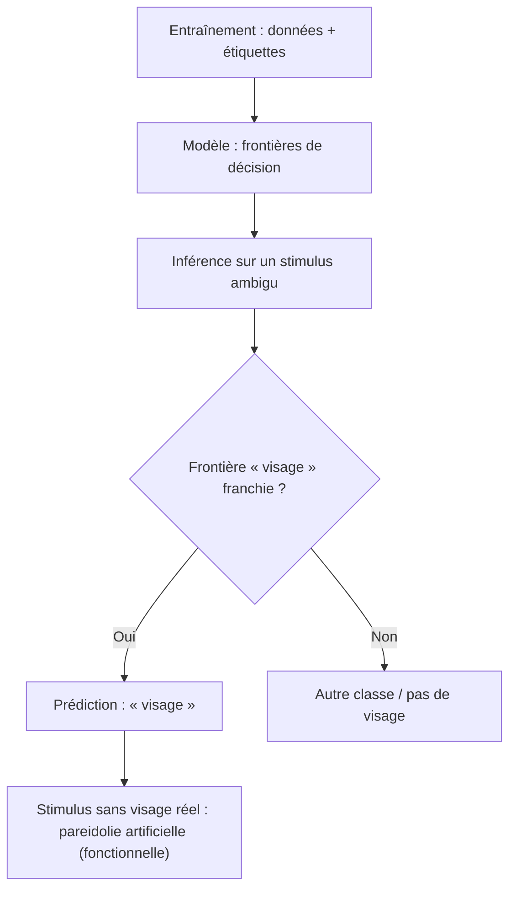

# **La paréidolie et l'IA**
<h3 align="center">Voir des visages là où il n'y en a pas : les IA le font aussi ?</h3><h3>

> **TL;DR.** Oui, les IA sont sujettes à la pareïdolie, mais de façon _fonctionnelle_ et _non phénoménale_. Elles classent « visage » des stimuli qui n'en contiennent pas, sans qu'on puisse démontrer la moindre expérience subjective.</h3>

<!-- > **Phrase pivot (à restituer à l'identique en examen)** : -->
> _« Les modèles de vision artificiels présentent des signatures comportementales et représentationnelles de paréidolie partiellement comparables à celles mesurées chez l'humain, avec un écart significatif persistant ; attribuer à une IA une expérience subjective paréidolique n'est étayé par aucune preuve empirique actuelle. »_
---
La **paréidolie** est la tendance de la perception à imposer une interprétation significative à un stimulus ambigu ou aléatoire (nuage, bruit, prise électrique) — y détecter un objet, un motif ou une signification là où il n'y en a pas<!-- ([Wikipedia, "Pareidolia"](https://en.wikipedia.org/wiki/Pareidolia))-->.  
La paréidolie est un sous-ensemble de l'**apophénie** (percevoir des liens significatifs entre choses sans relation<!--, [Wikipedia, "Apophenia"](https://en.wikipedia.org/wiki/Apophenia)-->).
<!-- ## Pourquoi le cerveau humain en produit (à numéroter 2 si réactivé, puis renuméroter la suite)
Le système de détection de visages est réglé « **large** » (*broadly tuned*) : c'est l'hypothèse de départ de [Gupta & Dobs, 2025](https://pubmed.ncbi.nlm.nih.gov/39869654/). Le **gyrus fusiforme** (FFA) répond sélectivement aux visages ([Kanwisher et al., 1997](https://www.jneurosci.org/content/17/11/4302)) ; [À SOURCER : réponse de la FFA aux visages paréidoliques — Kanwisher 1997 ne l'établit pas].
**Argument évolutionnaire (hypothèse, non démontrée)** : manquer un visage réel (prédateur) coûterait plus cher que détecter un visage absent. Hamilton et al. (2024) l'évoquent dans leur introduction ; leurs données suggèrent seulement que la détection de visages animaux explique une partie de l'écart homme-machine. -->
---
## **1. La preuve empirique avec les réseaux de neurones** <!--(à connaître absolument)-->
**Étude de référence** : Gupta & Dobs, « Human-like face pareidolia emerges in deep neural networks optimized for face and object recognition », *PLOS Computational Biology* 21(1), e1012751, **27 janvier 2025** ([article](https://journals.plos.org/ploscompbiol/article?id=10.1371/journal.pcbi.1012751), [PubMed](https://pubmed.ncbi.nlm.nih.gov/39869654)).  
**Hypothèse testée** : la paréidolie résulterait de l'optimisation du système visuel pour reconnaître à la fois des visages et des objets.  
**Protocole** : CNN entraînés sur des combinaisons de quatre tâches (identification de visages, détection de visages, catégorisation d'objets, détection d'objets), comparés aux signatures comportementales et aux **réponses neurales humaines (MEG)** via RSA (matrices de dissimilarité, [Kriegeskorte et al., 2008](https://pmc.ncbi.nlm.nih.gov/articles/PMC2605405/)).  
**Résultats** :
* Les CNN dont l'entraînement inclut la **catégorisation d'objets** représentent visages paréidoliques, visages réels et objets appariés de façon plus proche des réponses neurales que les autres.
* Seul le CNN entraîné à la fois à l'**identification de visages** et à la **catégorisation d'objets** s'appuie sur des traits faciaux (« yeux ») pour classer les stimuli paréidoliques en visages, comme chez l'humain.
* Les auteurs concluent au conditionnel (« may emerge ») : l'hypothèse est soutenue, non prouvée.

**Corpus de test complémentaire** : « Faces in Things » (Hamilton et al., ECCV 2024, [arXiv 2409.16143](https://arxiv.org/abs/2409.16143)) — **5 000 images web** annotées à la main (dérivées de LAION-5B). Les détecteurs de visages modernes testés ne présentent pas la paréidolie dans la même mesure que l'humain (**écart comportemental significatif**) ; un ajustement sur des visages d'animaux en réduit une partie.

Voici un schéma pédagogique simplifié :

## **2. Trois phénomènes à ne jamais confondre**
Phénomène | Stimulus | L'humain voit | Le modèle « voit » | Source
---|---|:-:|---|--:
**Fooling example** | image initiale non reconnaissable (bruit gaussien ou uniforme, image toute blanche ou toute noire) légèrement modifiée (ε = 32) | rien de reconnaissable | classe-cible à confiance élevée (API Google Cloud Vision : « Teddy bear » 0,73 depuis une image blanche ; « Hammer » 0,81 depuis une image noire) | [MDPI Sensors](https://www.mdpi.com/1424-8220/23/14/6378)
**Adversarial example** | image réelle perturbée imperceptiblement (FGSM, ε = 0,007, GoogLeNet) | l'objet réel (panda) | mauvaise classe à haute confiance (« panda » 57,7 % → « gibbon » 99,3 %) | [Goodfellow et al. 2014, FGSM](https://arxiv.org/abs/1412.6572)
**Hallucination (LLM)** | requête, parfois banale | — | contenu plausible mais faux ou fabriqué, présenté comme factuel | [IBM](https://www.ibm.com/think/topics/ai-hallucinations)

⚠️ **Attribution précise** : le concept d'exemple adversarial vient de Szegedy et al. ([arXiv 1312.6199, soumis le 21 déc. 2013](https://arxiv.org/abs/1312.6199)) ; la méthode FGSM et l'expérience panda→gibbon à 99,3 % sont de **Goodfellow, Shlens & Szegedy (2014 ; ICLR 2015)** — ne les confondez pas. Les « fooling images » (images inreconnaissables classées avec confiance) viennent de Nguyen, Yosinski & Clune (CVPR 2015) ; le terme « fooling examples » et sa définition formelle (non reconnaissable par l'humain, reconnu par le modèle) sont proposés par Zhang, Chen & Qian (2023), qui y opposent l'adversarial example (reconnaissable par les deux, mal classé par le modèle).
## **3. Pareidolie, hallucination : tableau discriminant**

Tableau discriminant

Critère | Pareidolie humaine | Pareidolie IA | Hallucination LLM
---|---|---|---
Sortie | Interprétation perceptive | Classification « visage » sur un stimulus sans visage | Contenu faux présenté comme vrai
Cause (hypothèses) | Détecteur de visages « large » ; pression évolutive supposée | Optimisation visages + objets (Gupta & Dobs) ; détection de visages animaux (Hamilton et al.) | Optimisation de la plausibilité statistique, données lacunaires ou bruitées, corrélations parasites (IBM)
Conscience de l'erreur | Souvent | Non intrinsèque (sauf calibration ou abstention explicite) | Non intrinsèque
Statut | Normal | Propriété émergente (Gupta & Dobs) | Défaut opérationnel, réductible mais non éliminable (IBM)

⚠️ Ce que ces phénomènes partagent est un **symptôme** (une sortie confiante, sans vérification externe, hors du domaine où le modèle est fiable), pas une cause unique : Goodfellow et al. attribuent les exemples adversariaux à la **linéarité** des modèles en haute dimension, non à la sur-généralisation, tandis qu'IBM relie les hallucinations à l'optimisation de la plausibilité statistique.

> _« L'hallucination (confabulation) des LLM et la paréidolie des modèles de vision partagent un symptôme — une sortie plausible et confiante, sans mécanisme de vérification — pas nécessairement la même cause ; elles diffèrent aussi par la nature de la sortie : perceptive pour l'une, propositionnelle pour l'autre. »_
## **4. DeepDream : la paréidolie rendue visible**
En **modifiant l'image d'entrée** par montée de gradient pour maximiser l'activation d'une couche choisie (et non les poids du réseau), on amplifie ce que le réseau y détecte : si un nuage ressemble un peu à un oiseau, le réseau le rend plus oiseau, et la boucle se renforce. Le réseau utilisé, entraîné surtout sur des images d'animaux, interprète volontiers les formes comme des animaux (Mordvintsev, Olah & Tyka, 2015, [Inceptionism](https://research.google/blog/inceptionism-going-deeper-into-neural-networks/) ; voir aussi [DeepDream](https://en.wikipedia.org/wiki/DeepDream)).

L'équivalent textuel a été tenté sur BERT : « [What does BERT dream of?](https://pair-code.github.io/interpretability/text-dream/blogpost/) » (PAIR). Les auteurs rapportent des résultats imprévisibles et peu concluants, car le langage est fait de jetons discrets.
## **5. La distinction**
Niveau | Contenu | Statut chez l'IA
---|---|---
**Paréidolie fonctionnelle** | classification « visage » à haute confiance sur un stimulus sans visage | ✅ **démontrée**, d'ampleur variable (moindre que chez l'humain pour les détecteurs testés par Hamilton et al.)
**Paréidolie représentationnelle** | géométrie interne alignée sur les réponses neurales (RDM, RSA) et traits faciaux exploités (« yeux ») | ⚠️ **mesurée** pour certains CNN (Gupta & Dobs), en cours de caractérisation
**Paréidolie phénoménale** | expérience subjective de voir un visage | ❌ **non démontrée** — Butlin et al. (2023) concluent qu'aucun système actuel n'est conscient

> 🎓 <!--**Formulation d'examen** : -->« Les modèles de vision artificiels présentent des signatures comportementales et représentationnelles de paréidolie partiellement comparables à celles mesurées chez l'humain. Il y a un écart significatif persistant ; attribuer à une IA une expérience subjective paréidolique n'est pas encore preuvé. »

## **6. Les Enjeux**
**Sécurité** : les exemples adversariaux et les *fooling examples* sont une surface d'attaque (évasion) ; ils se transfèrent d'un modèle à l'autre, y compris en boîte noire ;  
**Interprétabilité** : DeepDream et la visualisation de features sont des instruments pour comprendre ce qu'un modèle a appris ;  
**Ingénierie** : une classification à haute confiance sur une entrée hors distribution doit être traitée comme suspecte (filtrage OOD, calibration de confiance) — mais ces garde-fous sont insuffisants : même un modèle entraîné contre les attaques reste confiant sur ses erreurs (81,4 % de confiance moyenne chez Goodfellow et al.) ;  
**Gouvernance** : pour les hallucinations, IBM recommande données de qualité, RAG, supervision humaine et suivi continu.
## **8. L'auto-évaluation**

Q&A

1. **La paréidolie est-elle une maladie ?** Non — fonctionnement perceptif normal ; elle est étudiée comme marqueur clinique dans la maladie de Parkinson et la démence à corps de Lewy (DCL), mais le test de paréidolie classe mal les stades légers (AUC = 0,61 pour le trouble cognitif léger à corps de Lewy).  
1. **Fooling ou adversarial ?** Fooling : non reconnaissable par l'humain, reconnu par le modèle (souvent avec confiance élevée). Adversarial : reconnaissable par l'humain, perturbé, mal classé (ici à haute confiance).  
1. **Quand la paréidolie des IA est-elle « de type humain » ?** Selon Gupta & Dobs, lorsque le réseau est optimisé pour l'identification de visages dans un contexte de catégorisation d'objets : il s'appuie alors sur des traits faciaux (« yeux ») comme l'humain (hypothèse soutenue, non prouvée).  
1. **Pourquoi les détecteurs de visages sont-ils moins paréidoliques que l'humain ?** Hamilton et al. relèvent un écart significatif ; l'apprentissage de visages d'animaux en explique une partie.  
1. **Hallucination = paréidolie ?** Non : analogie fonctionnelle (sortie confiante non fondée), mais causes et sorties différentes — perceptive vs propositionnelle.  
1. **La paréidolie prouve-t-elle une conscience ?** Non : elle contraint la *fonction de perception*, pas la *phénoménologie*.

___
> ### **Sources**  
Gupta & Dobs (2025), *PLOS Comput. Biol.* 21(1) : e1012751 — [étude MEG](https://journals.plos.org/ploscompbiol/article?id=10.1371/journal.pcbi.1012751)  
Hamilton et al. (2024), Faces in Things, ECCV 2024 — [arXiv 2409.16143](https://arxiv.org/abs/2409.16143)  
Zhang, Chen & Qian (2023), fooling examples, *Sensors* 23(14) : 6378 — [MDPI Sensors](https://www.mdpi.com/1424-8220/23/14/6378)  
Nguyen, Yosinski & Clune (2015), *Deep Neural Networks Are Easily Fooled*, CVPR 2015, pp. 427–436
Szegedy et al. (arXiv 21 déc. 2013 ; ICLR 2014) — [arXiv 1312.6199](https://arxiv.org/abs/1312.6199)  
Goodfellow, Shlens & Szegedy (2014 ; ICLR 2015), panda→gibbon (FGSM) — [arXiv 1412.6572](https://arxiv.org/abs/1412.6572)  
Kriegeskorte, Mur & Bandettini (2008), RSA, *Front. Syst. Neurosci.* 2 : 4 — [PMC](https://pmc.ncbi.nlm.nih.gov/articles/PMC2605405/)  
Mordvintsev, Olah & Tyka (18 juin 2015), Inceptionism — [Google Research](https://research.google/blog/inceptionism-going-deeper-into-neural-networks/)  
Bäuerle & Wexler (PAIR), *What does BERT dream of?* — [blog](https://pair-code.github.io/interpretability/text-dream/blogpost/)  
IBM, *What are AI hallucinations?* — [IBM Think](https://www.ibm.com/think/topics/ai-hallucinations)  
Butlin et al. (2023), indicateurs de conscience — [arXiv 2308.08708](https://arxiv.org/abs/2308.08708)  
Pareidolias in dementia with Lewy bodies (2012) — [PMC3407420](https://pmc.ncbi.nlm.nih.gov/articles/PMC3407420/) ; test de paréidolie dans le trouble cognitif léger à corps de Lewy (2021) — [Wiley](https://onlinelibrary.wiley.com/doi/full/10.1002/gps.5546)  
<!-- > Kanwisher et al. (1997), FFA — [J. Neurosci.](https://www.jneurosci.org/content/17/11/4302) (à réactiver avec la section « Pourquoi le cerveau humain en produit ») -->