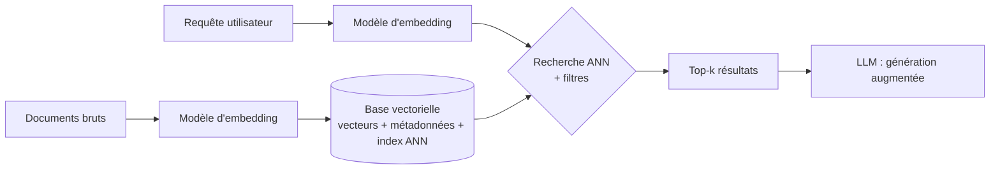

# **Qu'est-ce qu'une base de données vectorielle**<a href="https://github.com/MiKL5/artificial-intelligence"></a>
Une base de données vectorielle **stocke, gère et indexe des données vectorielles de haute dimension**. Chaque point de données est un tableau de nombres (un *vecteur*). On peut comparer ces vecteurs et les regrouper selon leur **similarité**. Cette conception permet des requêtes à faible latence, d'où son intérêt pour les applications d'IA.<br><br>
Selon une étude de 2025 citée par IBM, l'adoption de ces bases a augmenté de **377 % en un an**. C'est la croissance la plus rapide enregistrée pour une technologie liée aux LLM.
---
## Vecteurs et embeddings
### Hiérarchie des tenseurs
Objet | Ordre | Exemple IBM
---|--:|---
Scalaire | 0 | `85` (température max)
Vecteur | 1 | `[62, 77, 85]` (min, moyenne, max)
Matrice et tenseurs d'ordre supérieur | ≥ 2 | Groupes de vecteurs
### Embeddings vectoriels
Un **embedding** est une représentation numérique d'une donnée (texte, image, etc.). Un modèle d'embedding apprend à projeter les entrées dans un espace de haute dimension. Une **fonction de perte** propre à la tâche façonne cet espace.

Les dimensions sont des **caractéristiques latentes**, c'est-à-dire déduites et non nommées. Des éléments proches sémantiquement ont des vecteurs proches : « chat » `[0,2 ; -0,4 ; 0,7]` et « chien » `[0,6 ; 0,1 ; 0,5]`. Il en va de même pour « voiture » et « véhicule ».
## Fonctionnement
Trois fonctions principales :
1. **Stockage** : embeddings à dimension fixe, accompagnés de métadonnées (titre, source, horodatage, catégorie) filtrables. Les embeddings sont **pré-calculés**, donc non recalculés à la requête. La **recherche hybride** combine similarité vectorielle et filtres de métadonnées.
2. **Indexation** : structures permettant la recherche approximative des plus proches voisins (**ANN**), sans balayer tout le jeu de données.
3. **Recherche** : le prompt est converti en *vecteur de requête*. La base le compare aux vecteurs indexés, calcule des scores de similarité et renvoie les k plus proches voisins en quelques millisecondes.

### Algorithmes d'indexation
Technique | Principe
---|---
**HNSW** | Graphe hiérarchique multicouche : liens longue portée en haut, liens locaux denses en bas
**LSH** | Fonction de hachage qui place les vecteurs similaires dans le même groupe
**PQ** (quantification de produit) | Compression : codes courts qui préservent les distances relatives, ce qui réduit la mémoire
## Métriques de similarité
Métrique | Mesure
---|---
Similarité cosinus | Distance angulaire (alignement des directions)
Produit scalaire | Direction et magnitude
Distance euclidienne | Distance en ligne droite
Similarité de Jaccard | Chevauchement entre deux ensembles
Distance de Hamming | Positions différentes entre vecteurs binaires
#### 🧩 Formules et bonne pratique
$$
\cos(\theta)=\frac{\vec a\cdot\vec b}{\lVert\vec a\rVert\,\lVert\vec b\rVert} \qquad d_2(\vec a,\vec b)=\sqrt{\sum_i (a_i-b_i)^2}
$$  
La métrique doit être **celle sur laquelle le modèle d'embedding a été entraîné**. Sur des vecteurs normalisés (norme 1), cosinus et produit scalaire donnent le même classement.
## Comparaison avec le relationnel
Critère | Base relationnelle / recherche classique | Base vectorielle
---|---|---
Données | Structurées et semi-structurées, schéma défini | Non structurées (texte, image, vidéo, audio) via embeddings
Requête | Correspondance exacte (mots-clés, balises) | Proximité sémantique
« smartphone » | Ne renvoie que ce terme précis | Renvoie aussi « téléphone portable » et « appareil mobile »
Indexation | B-tree, hash, etc. | HNSW, LSH, PQ
Passage à l'échelle | Selon le moteur | Horizontal, par ajout de nœuds
## Cas d'usage et limites
* **RAG (génération augmentée de récupération)** : le LLM s'appuie sur une base de connaissances externe. Cela réduit le risque d'hallucination et permet de citer les sources.
* **IA conversationnelle** : réponses contextuelles avec documents sources et numéros de page.
* **Moteurs de recommandation** : e-commerce, streaming, réseaux sociaux.
* **Détection d'anomalies** : fraude, défaillances, trafic réseau, capteurs industriels. On repère les points éloignés des clusters.

**Limite** : pour la synthèse d'un sujet entier ou l'analyse thématique globale, il faut que le LLM lise tous les contextes pertinents. Un index de liste ou une autre structure non vectorielle est alors plus efficace que les seuls voisins les plus proches.
### Avantages revendiqués
Vitesse, évolutivité horizontale, coût de possession plus faible, gestion des données (mise à jour et insertion), flexibilité multimodale.
## Choisir sa solution
Famille | Exemples (IBM)
---|:-:
Autonome propriétaire | Pinecone
Open source | Weaviate, Milvus
Lakehouse avec capacités vectorielles | IBM watsonx.data
Extension d'une base existante | **pgvector** (PostgreSQL)
Moteur de recherche avec support vectoriel | OpenSearch
Serverless | Idéal pour le prototypage, l'événementiel et la maîtrise des coûts

**Outillage** : LangChain (Python et JavaScript, plus de 1 000 intégrations) pour orchestrer LLM, embeddings et bases vectorielles.
#### 🧩 Grille de décision
Question | Orientation
---|---
Déjà sous PostgreSQL, moins de quelques millions de vecteurs ? | pgvector
Souveraineté, auto-hébergement, pas de verrouillage ? | Milvus, Weaviate ou Qdrant en open source, hébergés dans l'UE
Zéro exploitation ? | Serverless managé (vérifier le lieu d'hébergement et les transferts hors UE)
Filtrage de métadonnées intensif ? | Tester la recherche hybride en conditions réelles
Réversibilité ? | Conserver les données sources et le modèle d'embedding versionné
## 🧩 Conformité : RGPD et AI Act
> Ces points sont des repères pédagogiques, pas un avis juridique. À valider avec un DPO ou un juriste.
**RGPD (règlement (UE) 2016/679)**
* Un embedding dérivé d'une donnée personnelle peut rester une **donnée personnelle** (art. 4.1), même s'il n'est pas lisible. Le risque de ré-identification ou d'inversion d'embedding doit être évalué.
* **Minimisation, limitation des finalités et durée de conservation** (art. 5) : ne vectorisez que le nécessaire.
* **Droit à l'effacement** (art. 17) : prévoyez la suppression d'un vecteur, de ses métadonnées, des sauvegardes et des index. Vérifiez comment le moteur traite les suppressions dans HNSW (marqueurs de suppression, reconstruction de l'index).
* **Protection dès la conception** (art. 25), **sécurité** (art. 32), **AIPD** (art. 35) pour les traitements à risque élevé.
* **Transferts hors UE** (chap. V) en cas d'hébergement serverless américain.
* Voir aussi l'avis 28/2024 du CEPD sur les modèles d'IA et les données personnelles.

**Règlement (UE) 2024/1689 (AI Act)**
* Le RAG entre dans le champ du règlement dès qu'il alimente un système d'IA. La qualification dépend de l'usage (système à haut risque, obligations de transparence, etc.).
* Les exigences de gouvernance des données, de traçabilité et de supervision humaine s'appliquent aux systèmes à haut risque.
* Les obligations s'appliquent par étapes. Vérifiez le calendrier en vigueur, car des reports sont en discussion.

**Autres points** : droit d'auteur et fouille de textes (directive (UE) 2019/790), secret des affaires, droit du travail si les données sont celles de salariés.
## 🧩 Sécurité, qualité, éco-conception
* **Contrôle d'accès** par document ou par locataire. Appliquez le filtre *avant* la restitution au LLM, pour éviter les fuites inter-utilisateurs.
* **Injection de prompt indirecte** : un document malveillant indexé peut détourner le LLM. Isolez et assainissez les contenus.
* **Empoisonnement des données** : contrôlez la provenance des documents ingérés.
* **Chiffrement** au repos et en transit, journalisation, gestion des secrets.
* **Qualité** : mesurez le *recall@k* face à une recherche exacte. Évaluez le RAG (pertinence des passages, fidélité de la réponse). Versionnez les modèles d'embedding : changer de modèle impose de tout ré-indexer.
* **Éco-conception** : réduisez la dimension des vecteurs, quantifiez (PQ), évitez les ré-indexations inutiles, dimensionnez les clusters au besoin réel.
## Compétences à maîtriser
Domaine | Compétences
---|---
Mathématiques | Algèbre linéaire, normes, géométrie en haute dimension (fléau de la dimensionnalité)
ML/NLP | Modèles d'embedding, fonctions de perte, évaluation
Algorithmique | ANN, HNSW, LSH, PQ, compromis rappel/latence/mémoire
Ingénierie | Python, SQL/pgvector, API REST, LangChain, Docker
Données | Pipelines d'ingestion, métadonnées, gouvernance et traçabilité
Exploitation | Observabilité, SLO de latence, montée en charge
Droit et éthique | RGPD, AI Act, biais, transparence
## 🧩 Exemple minimal (PostgreSQL + pgvector)
```sql
CREATE EXTENSION IF NOT EXISTS vector;

CREATE TABLE documents (
                        id        bigserial PRIMARY KEY,
                        contenu   text NOT NULL,
                        categorie text,
                        embedding vector(384)
);

CREATE INDEX ON documents USING hnsw (embedding vector_cosine_ops);

-- Cinq plus proches voisins (distance cosinus) avec filtre de métadonnées
SELECT id, contenu
FROM documents
WHERE categorie = 'rh'
ORDER BY embedding <=> '[...]'::vector
LIMIT 5;
```
## Glossaire
Terme | Définition
--:|---
ANN | Recherche approximative des plus proches voisins
Embedding | Représentation vectorielle dense d'une donnée
HNSW | Graphe hiérarchique navigable de petits mondes
LSH | Hachage sensible à la localité
PQ | Quantification de produit
RAG | Génération augmentée de récupération
Recherche hybride | Similarité vectorielle combinée à des filtres de métadonnées
___
> Références
> * [IBM Think – Base de données vectorielle](https://www.ibm.com/fr-fr/think/topics/vector-database)
> * Malkov & Yashunin, *Efficient and robust approximate nearest neighbor search using Hierarchical Navigable Small World graphs* (HNSW)
> * Les sections marquées 🧩 sont des compléments hors article IBM, à vérifier avant diffusion.